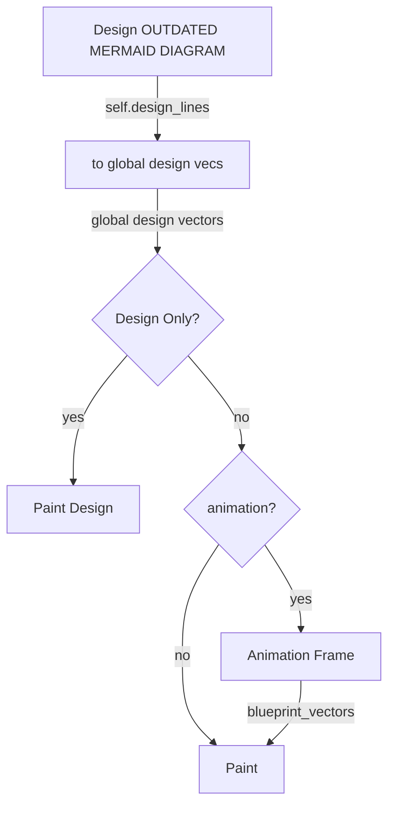

# Animation no rotation:

## infinite reverse scaling (zoom) animation:

There is a three way now:

diagram moved into code: `animation_structs_and_enums.rs`

Thoughts:
enum with three stages:

- init_scaling
- post_scale_loop
- pre_scale_loop

# NOTE:

## DROPBOX and ICLOUD

move away from drop box and icloud storage.
now I often have to

    sudo chown -R mjvandermeulen .

in the root dir of the project

# RAYON

~~no improvements found. Only kept for benching...~~
removed, since no improvement found: reason: long Shapes Vecs?

# TODO

## NOW

- [x] Add Pause Animation (MOVING ALL PAINT CODE INTO ANIMATION FOR NOW.
- [ ] FIX wrong name for paint_fractal (currently "animate")
- [ ] Set speed in "2x zoom per minute" (currently seconds/cycles)
- [ ] UI change of `animation_repetition_cycle` => "repeat when showing" (Tool tip: percentage of length showing when repetition can start)
- [x] FIX: animation rainbow.
- [x] Replace Line animation: Don't fade
- [x] **FIX REPLACE LINE!**
- [ ] **Reset depth when you make a change. :). Default to yes.**

### Animation quick now

## This mermaid is outdated.

Make it work again: Now multiple functions when animating. (functional programming ish ish ish)



- [ ] add animation length slider
- [x] always have a default animation: no Option needed!

### Animation bigger

- [ ] ....

## FIX

- [ ] use "initiator" and "generator"

## NOTE

- [ ] I have changed the naming to vec and rot (~~dir vs rot: dir is absolute. rot is relative.~~)
- [ ] vec and **rot** CAN INCLUDE SCALING!
    - [ ] It's cleaner to use a non scaling rotation _and_ scaling. (UI design: use this strategy)
    - [ ] To only do a simple matrix multiplication (Computation critical): Use only a Rot2

## LATER

- [x] reset Zoom button
- [ ] fractals. START ALL WITH ONLY DEPTH = 1. NO SPOILER
    - [ ] twig
    - [ ] tree
    - [ ] leaf (not mirrored, 2 branches)
    - [ ] snowflake
    - [ ] squares
- [x] ?DONE? on free/tree/loop switch: update design_lines
- [x] fine tune:
    - [x] Alt: 10 times
    - [x] Ctrl: 100 times
- [ ] hover to select line, then drag or flip that line
- [x] add branches by drawing
- [ ] show design line count
- [ ] offer to delete the shortest design line
- [ ] criterion bench: regroup?

## MUCH LATER

- [ ] show design params in ui and allow to manually set the numbers.

# THOUGHTS

- the width of the line is independent of the screen size!
- for the crucial fast shape painting: Are we using Rot2 to scale and rotate? (In the transformations)

# Design

keys:

- up down: level
- 0..8: depth level
- 9: deepest level

- press and hold d (or SHIFT-D to toggle): Show design
- alt 10x fine tune
- ctrl: 100x fine tune

- two finger scroll
- pinch zoom

# Structs and such:

## Node

_Oct 2026: I'm confused about this wording. Node was used in the original clock fractal for what's now called a Branch. Here it's a "View"._

A Node is like the new view you create on a phone when you stretch, rotate and move an image on a phone with two fingers. It's defined by a position and a vector.

Zoom: ===> Node, Zoom is the top zoom in the settings...

- position
- vector
- line_width

## Transformation

- Translation
- Rotation (includes scaling)

# Thoughts

## width of line

~~The vector length determines the thickness of the line. maybe....~~ Not the case now, but I'd like it.

What if you start the first gen branches with thickness 1?

# FIX HANGING ON START:

```

cd /Users/mjvandermeulen/Library/Application Support/egui-demo-app
ls
app.ron

```

remove the app.ron file.
