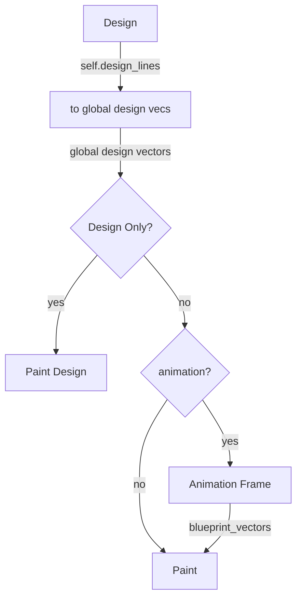

# Animation no rotation:

## Thoughts

When not rotating the fractal, the total progress is important, to determine the "fake (zoom) rotation". Scaling will stop and be put on repeat, but the zoom rotation will always continue.

## BIG IDEA

_When reaching the `fractal.animation_repetition_cycle` start rotating and **reset the scaling every cycle**_

```rust
    // before reaching the fractal.animation_repetition_cycle
    scale = progress * cycle_scale
    rotation = 0.0

    // after reaching the fractal.animation_repetition_cycle
    scale = (fractal.animation_repetition_cycle + progress.fract()) * cycle_scale
    rotation = progress.floor() * -cycle_rotation // which way???
```

## Terminology

`f32`

- progress: MAKE THIS The full progress: Time elapsed / fractal.animation.cycle_length

Whole cycles:

- `progress.floor()`: the number of cycles since the start.
- `fractal.animation_repetition_cycle`
- `cycles_since_repetition` = `progress.floor()` - `fractal.animation_repetition_cycle`.
  **This determines how much to rotate to give illusion of zooming**:

# NOTE:

## DROPBOX and ICLOUD

move away from drop box and icloud storage.
now I often have to

    sudo chown -R mjvandermeulen .

in the root dir of the project

# RAYON

~~no improvements found. Only kept for benching...~~
removed, since no improvement found: reason: long Shapes Vecs?

# TODO

## NOW

### Animation quick small

- [x] add scaling: ratio.pow(progress)
- [x] refactor BIG: width always ratio of length. Otherwise animation is wrong: when scaling endpoints the length of the line changes!
- [x] refactor: don't translate design point, but the global design vectors.



- [ ] add animation length slider
- [x] always have a default animation: no Option needed!

### Animation bigger

- [ ] ....

## FIX

- [ ] use "initiator" and "generator"

## NOTE

- [ ] I have changed the naming to vec and rot (~~dir vs rot: dir is absolute. rot is relative.~~)
- [ ] vec and **rot** INCLUDE SCALING!

## LATER

- [x] reset Zoom button
- [ ] fractals. START ALL WITH ONLY DEPTH = 1. NO SPOILER
    - [ ] twig
    - [ ] tree
    - [ ] leaf (not mirrored, 2 branches)
    - [ ] snowflake
    - [ ] squares
- [x] ?DONE? on free/tree/loop switch: update design_lines
- [x] fine tune:
    - [x] Alt: 10 times
    - [x] Ctrl: 100 times
- [ ] hover to select line, then drag or flip that line
- [x] add branches by drawing
- [ ] show design line count
- [ ] offer to delete the shortest design line
- [ ] criterion bench: regroup?

## MUCH LATER

- [ ] show design params in ui and allow to manually set the numbers.

# THOUGHTS

- the width of the line is independent of the screen size!
- for the crucial fast shape painting: Are we using Rot2 to scale and rotate? (In the transformations)

# Design

keys:

- up down: level
- 0..8: depth level
- 9: deepest level

- press and hold d (or SHIFT-D to toggle): Show design
- alt 10x fine tune
- ctrl: 100x fine tune

- two finger scroll
- pinch zoom

# Structs and such:

## Node

_Oct 2026: I'm confused about this wording. Node was used in the original clock fractal for what's now called a Branch. Here it's a "View"._

A Node is like the new view you create on a phone when you stretch, rotate and move an image on a phone with two fingers. It's defined by a position and a vector.

Zoom: ===> Node, Zoom is the top zoom in the settings...

- position
- vector
- line_width

## Transformation

- Translation
- Rotation (includes scaling)

# Thoughts

## width of line

~~The vector length determines the thickness of the line. maybe....~~ Not the case now, but I'd like it.

What if you start the first gen branches with thickness 1?

# FIX HANGING ON START:

```

cd /Users/mjvandermeulen/Library/Application Support/egui-demo-app
ls
app.ron

```

remove the app.ron file.
