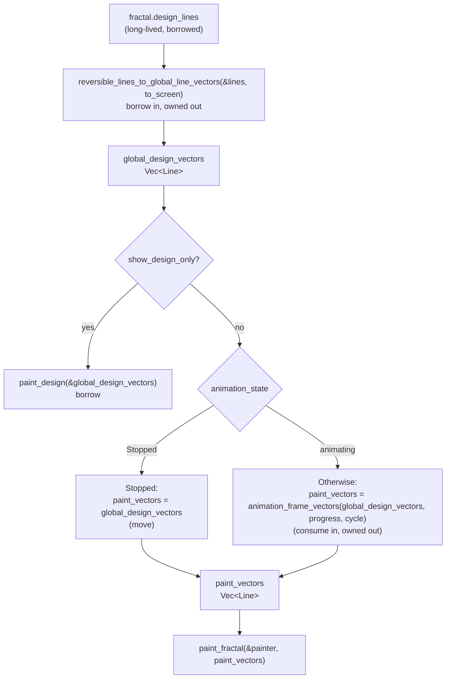

# Claude

The two branches merge into `paint_vectors`, which is the point of the name: it's defined by its role (the input to `paint_fractal`), not by how it was produced. I put the ownership notes (borrow, move, consume) on the nodes so the diagram doubles as a map of where each value is used up. If you'd rather have a cleaner diagram, delete the parenthetical lines.
